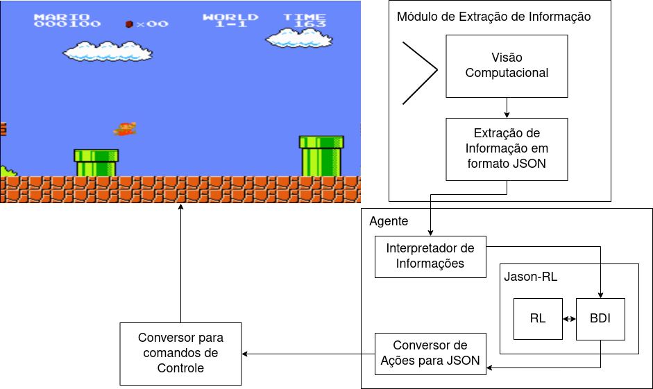
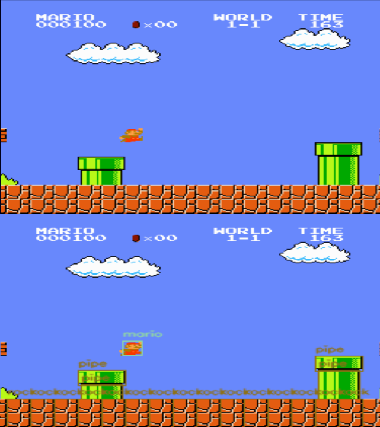
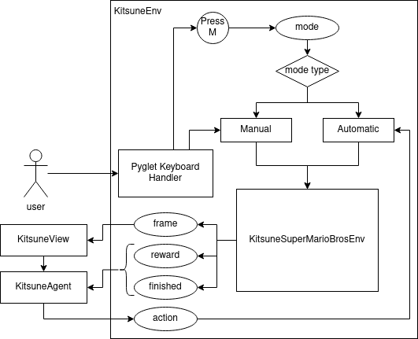
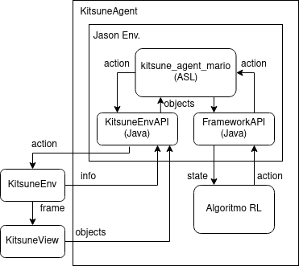

# KITSUNE AI
## NES Game AI Framework – Reinforcement Learning + Evolutionary Algorithm + BDI

> Modular AI framework for NES games using Reinforcement Learning, Evolutionary Algorithm, BDI reasoning, and multi-language integration

<table>
  <tr>
    <!-- Big image on the left -->
    <td bgcolor="white">
      Architecture
      
    </td>
    <!-- Small images on the right -->
    <td>
      Object Detections
      
    </td>
  </tr>
  <tr>
    <td>
      Enviroment Module Diagram
      
    </td>
    <td>
      Agent Module Diagram
      
    </td>
  </tr>
</table>

## About the Project

This project presents a **modular AI framework** capable of playing NES games, combining multiple AI approaches and languages in a single pipeline.

The architecture includes:  
- **Agent (AGT)**: Receives perceptions from the environment, decision and reasoning using **Agent Speak Language (ASL)**.  
- **Environment (ENV)**: Built in Java to simulate the game world and provide input/output for the agent as well in Python to get information from the game.  
- **Reaction Modules (Python)**: **Reinforcement Learning (RL)** or **Evolutionary Algorithm (EA)** was used as example of **Machine Learning** technics that can be used to build Agents conceptions and acknowledgement.  
- **Kitsune Module (Python)**: Integrates each kitsune module **Agent, Environment, and View**, connecting all components via **local sockets/Flask**. For visualization we used classical computer vision, finding assets in each frame, this can be enhanced using YOLO and others technics.  
- **Game Definitions (Games)**: Currently includes a **Super Mario Bros NES environment**, simulated with **nes-py** for handling inputs and outputs.

This modular framework allows experimentation and extension for **any NES game**, with Super Mario Bros as a **proof-of-concept**.

---

## Features

- Multi-language agent-environment integration (**Java + Python**)  
- Agent Speak Language (ASL) for AI reasoning  
- **Reinforcement Learning** and **Evolutionary Algorithm** for continuous learning  
- Kitsune module connects all components and provides visualization  
- Modular design for experimentation with any NES game, ML and Computer Vision approach
- Current game simulation: **Super Mario Bros** via nes-py  

---

## Paper / Reference

This project is based on my bachelor thesis:

**Robson Zagre Junior. (2022).Kitsune AI: Uma arquitetura utilizando Agente BDI e Aprendizagem por Reforço para jogar jogos de NES. Bachelor’s Thesis, Federal University of Santa catarina. [PDF](https://repositorio.ufsc.br/handle/123456789/237816)**
